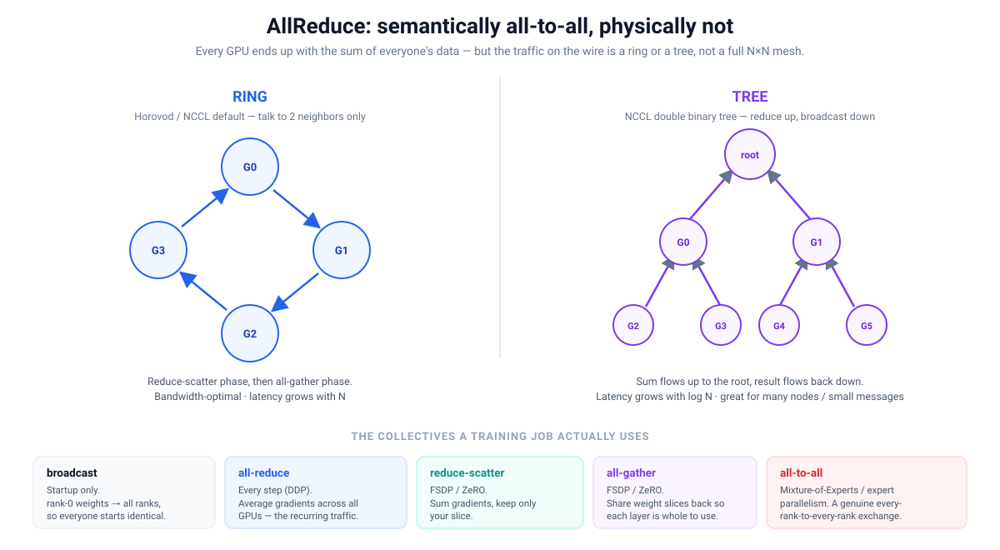
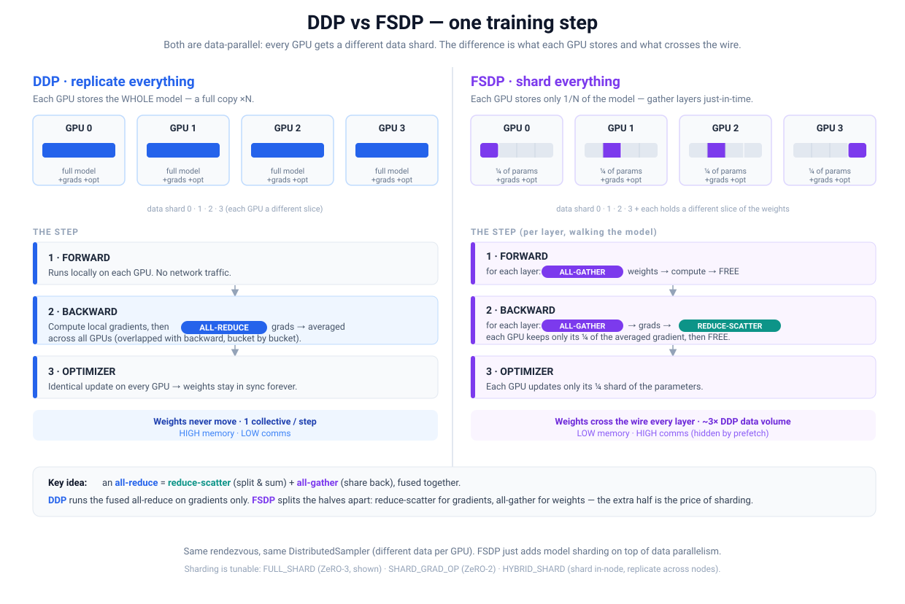

# Distributed Training on OpenShift: AllReduce, DDP, and FSDP

A primer on how data-parallel workers synchronize during training, what
"allreduce traffic" actually is, how to choose the collective in an MPIJob,
and how DDP and FSDP differ. Grounded in the MPIJob examples in this repo
(`tests/mpiv2/test-3` Horovod, `tests/mpiv2/test-4` PyTorch DDP).

---

## 1. Gradients, loss, and parameters (the 30-second version)

- **Parameters** are the model's weights — the millions/billions of numbers being learned.
- **Loss** is a single number measuring "how wrong is the model right now" on a batch.
- **Gradient** is, for *each parameter*, the slope of the loss with respect to that
  weight: which direction to nudge it to make the loss go down, and how strongly it
  matters. A model with N parameters has a gradient with N numbers.

One training step:

1. **Forward** — run the batch through the model, compute the loss.
2. **Backward** (backpropagation) — compute the gradient of the loss w.r.t. every weight.
3. **Optimizer step** — move each weight against its gradient: `w = w − lr × grad`.

Repeat thousands of times → **gradient descent**.

### Why workers only exchange gradients, never parameters

In data-parallel training every worker holds an **identical copy** of the model and
processes a **different slice of the batch**. So each worker computes a slightly
different gradient — its own estimate of "which way is downhill." Workers then
**average the gradients** with an allreduce and apply the *same* update locally.

Because all workers start identical (a one-time `broadcast` of rank-0's weights at
startup) and apply identical updates, the parameters stay in lockstep **without ever
being transmitted after step 0**. This is why the recurring traffic each step is the
gradients — one value per weight, so the message size ≈ the model size, every step.

---

## 2. Is allreduce "all-to-all"? Kinds of allreduce traffic

**Semantically yes, physically no.** The *result* of an allreduce is that every
worker holds the sum/average of every worker's contribution — logically all-to-all.
But the actual wire pattern is almost never a full N×N mesh, because that would waste
bandwidth.



Common implementations:

- **Ring** (Horovod / NCCL default): workers form a logical ring; each talks only to
  its 2 neighbors. Runs as a reduce-scatter phase then an all-gather phase. Nearly
  bandwidth-optimal regardless of worker count, but latency grows linearly with N.
- **Tree** (NCCL double binary tree): reduce up a tree, broadcast back down. Latency
  grows as log N — wins for small messages or large worker counts.
- **Recursive halving/doubling (Rabenseifner)**: what MPI libraries often pick for
  `MPI_Allreduce` on CPU — a butterfly pattern of pairwise exchanges, log N steps.
- **Hierarchical**: fast intra-node allreduce (NVLink) first, then one inter-node
  exchange per node.

NCCL picks the algorithm automatically per message size and topology (tunable with
`NCCL_ALGO=Ring|Tree`).

### It's not all "allreduce" — a job uses several collectives

| Collective | When | What it does |
|---|---|---|
| `broadcast` | startup | rank-0 weights → all ranks, so everyone starts identical |
| `all-reduce` | every step (DDP) | average gradients across all GPUs — the recurring traffic |
| `reduce-scatter` | FSDP / ZeRO | sum gradients, each GPU keeps only its slice |
| `all-gather` | FSDP / ZeRO | share weight/param slices back so a layer is whole to use |
| `all-to-all` | Mixture-of-Experts | a genuine every-rank-to-every-rank exchange |

**Key identity:** `all-reduce = reduce-scatter + all-gather`, fused. DDP runs the fused
version on gradients. FSDP splits the two halves apart (see §4).

### On this OpenShift setup

In the MPIJobs, **MPI/SSH is only the control plane** — the launcher SSHes into workers
to start processes and rendezvous. The allreduce **data plane** is direct
worker-pod-to-worker-pod traffic: NCCL over TCP on the pod network for GPU jobs (or
RDMA if available), or MPI/Gloo over TCP for the CPU variants. For a 4-worker ring
allreduce you'd see each worker pod holding sustained streams to exactly two peers, not
to all three.

---

## 3. Choosing the allreduce type in an MPIJob

**The MPIJob CRD has no "allreduce type" field.** You choose it through **environment
variables** and **`mpirun` flags** that flow down to the training processes. There are
three independent knobs:

### Level 1 — Which library runs the allreduce

**Horovod** picks it with env vars:
- `HOROVOD_GPU_OPERATIONS` → `NCCL` (default on GPU) or `MPI`
- `HOROVOD_CPU_OPERATIONS` → `MPI`, `GLOO`, `NCCL`, or `CCL`

In `tests/mpiv2/test-3/tf-mnist-hvd-mpijob-cpu.yaml` this is an explicit choice:

```yaml
- name: HOROVOD_CPU_OPERATIONS
  value: "MPI"      # allreduce goes through Open MPI's MPI_Allreduce
```

The GPU job (`tf-mnist-hvd-mpijob.yaml`) sets no override, so Horovod defaults to
**NCCL** on GPU — hence only `NCCL_DEBUG=INFO` appears there.

**PyTorch DDP** (`tests/mpiv2/test-4`) picks it in the *Python script*, via
`dist.init_process_group(backend="nccl" | "gloo" | "mpi")`.

> Rule of thumb: **GPU → NCCL**, **CPU → MPI or Gloo**.

### Level 2 — Which algorithm (ring vs tree)

- **NCCL** (GPU jobs): `NCCL_ALGO=Ring|Tree`, `NCCL_PROTO=Simple|LL|LL128`.
- **Open MPI** (CPU job): `mpirun ... -mca coll_tuned_use_dynamic_rules 1 -mca coll_tuned_allreduce_algorithm N`
  (`4`=ring, `3`=recursive doubling, `6`=rabenseifner).

### Level 3 — Which network path (transport)

- **Open MPI**, from `tf-mnist-hvd-mpijob-cpu.yaml`: `-mca pml ob1 -mca btl self,vader,tcp`
  (self = self, vader = shared memory same-node, tcp = pod network cross-node).
- **Open MPI**, from `torch-ddp-mpijob.yaml`: `-mca btl ^openib` (exclude InfiniBand on an
  Ethernet-only cluster).
- **NCCL**: `NCCL_SOCKET_IFNAME`, `NCCL_IB_DISABLE=1`, `NCCL_NET_GDR_LEVEL`.

### Where to set these — and the gotcha

Set them as `env:` on the Launcher/Worker container, **and** forward them onto the
`mpirun` line with `-x VAR`. The gotcha: **mpirun launches the training processes over
SSH, and an SSH session does not inherit the Worker pod's `env:` block.** So a variable
the process must see (`NCCL_ALGO`, `HOROVOD_CPU_OPERATIONS`, …) has to be forwarded with
`-x`, which is exactly why the repo jobs list them twice (once in `env:`, once as
`-x ...` on mpirun). Add a new tuning var → add a matching `-x`.

| To change… | NCCL (GPU jobs) | Open MPI (CPU job) |
|---|---|---|
| Library | `HOROVOD_GPU_OPERATIONS=NCCL` (default) | `HOROVOD_CPU_OPERATIONS=MPI` |
| Algorithm | `NCCL_ALGO=Ring\|Tree` | `-mca coll_tuned_allreduce_algorithm N` |
| Transport | `NCCL_SOCKET_IFNAME`, `NCCL_IB_DISABLE` | `-mca btl self,vader,tcp` |

---

## 4. DDP vs FSDP

Both are **data-parallel**: every GPU gets a different data shard, using the same
rendezvous and the same `DistributedSampler`. FSDP adds **model sharding** on top — it
does not replace data parallelism.



### DDP — replicate everything, sync gradients

Every GPU stores a **full copy** of parameters, gradients, and optimizer state.

```
1. FORWARD    local compute, no network
2. BACKWARD   compute local grads, then ALL-REDUCE (average across all GPUs),
              overlapped with backward, bucket by bucket
3. OPTIMIZER  identical update on every GPU → weights stay in sync
```

- Weights never cross the wire after startup.
- One collective per step (allreduce of gradients), message ≈ model size.
- **High memory, low comms.**

### FSDP (ZeRO-3) — shard everything, gather just-in-time

Each GPU permanently stores only **1/N** of the parameters, gradients, and optimizer
state. Each layer's full weights are reassembled only at the moment they're needed,
then freed.

```
FORWARD    per layer:  ALL-GATHER weights → compute → FREE
BACKWARD   per layer:  ALL-GATHER weights → grads → REDUCE-SCATTER grads
                       (each GPU keeps its 1/N) → FREE
OPTIMIZER  each GPU updates only its 1/N shard
```

- At any instant a GPU materializes only **one layer's** full weights → the memory win.
- **Reduce-scatter** replaces DDP's allreduce for gradients; **all-gather** of weights is
  new traffic DDP never had, on every forward and backward.
- ~3× DDP's data volume, hidden behind compute via **prefetch** (gather layer N+1 while
  computing layer N). Wants fast interconnect (NVLink / InfiniBand).
- **Low memory, high comms.**

### At a glance

| | DDP | FSDP (FULL_SHARD / ZeRO-3) |
|---|---|---|
| Each GPU stores | full params + grads + opt (×N) | 1/N of params + grads + opt |
| Gradient sync | one **all-reduce** / step | **reduce-scatter** per layer |
| Weight sync | none (weights never move) | **all-gather** per layer, fwd + bwd |
| Data volume | 1× | ~3× |
| Tradeoff | high memory, low comms | low memory, high comms |

### Sharding is tunable (ZeRO stages)

PyTorch FSDP `ShardingStrategy`:
- `FULL_SHARD` (ZeRO-3) — shard params + grads + optimizer. Max memory savings, most comms.
- `SHARD_GRAD_OP` (ZeRO-2) — shard grads + optimizer; keep forward-gathered params resident
  until backward. Fewer gathers, more memory.
- `HYBRID_SHARD` — shard within a node, replicate across nodes (reduce-scatter in-node,
  allreduce across nodes). Often the sweet spot on multi-node Ethernet clusters.

---

## TL;DR

- Workers sync by **averaging gradients** each step and applying identical updates;
  parameters never travel after startup.
- Allreduce is **all-to-all in effect, ring/tree on the wire**.
- In an MPIJob you choose the collective via **env vars + `mpirun -x/-mca` flags**, not a
  CRD field — remember to forward vars with `-x`.
- **DDP** replicates the model and allreduces gradients (high memory, low comms). **FSDP**
  shards the model, all-gathers weights per layer, and reduce-scatters gradients (low
  memory, high comms) — enabling models far bigger than one GPU.
